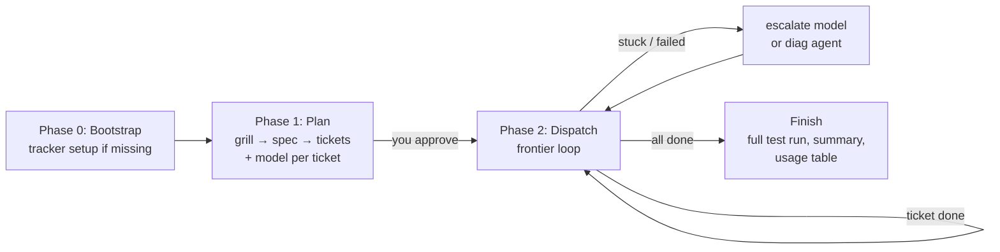

# feature-flow

Build a feature with a team of agents inside [Herdr](https://herdr.dev). You plan with one orchestrator agent in your own pane (grill the idea, write a spec, cut it into tickets), then it dispatches one fresh worker agent per ticket into panes beside you, each running `/implement`. It watches them, answers what the spec already answers, brings you everything else, escalates failing tickets to a stronger model, and keeps a per-agent usage ledger. You stay in one pane and make the decisions.

## Use cases

- A feature big enough for a spec and 3-10 tickets, and you want each ticket built by a fresh agent with a clean context.
- Cheap models for mechanical tickets and a stronger one for judgment calls, chosen per ticket and shown to you before anything runs.
- Several independent tickets built at once, each in its own git worktree (opt-in).
- A worker is stuck or keeps failing: the orchestrator notices, steers or restarts it, and sends a diagnosis agent.
- Your PR/MR got review comments: a review agent walks you through them while fix tickets go to new workers.
- After the run, a token-usage and `/cost` table per agent.

## When not to use it

- A change you can make in one sitting with one agent. The planning and dispatch overhead is not worth it.
- You are not inside Herdr, or not using Claude Code workers. The skill stops at once without `HERDR_ENV=1`.
- The idea is still foggy. Run `/wayfinder` first and come back at `/to-spec`.

## How it works

### Phase flow



The **frontier** is every ticket whose blockers are done. For each one the orchestrator starts a fresh worker, prompts `/implement <ticket>`, waits, and then checks for a commit and test output, because an idle agent is not proof of done. A worker that asks a question settles as idle; the orchestrator answers only what the spec answers outright and relays the rest to you verbatim.

### Pane layout

```
┌──────────────────────┬──────────────────────┐
│                      │ impl-01              │
│   orchestrator       ├──────────────────────┤
│   (you talk here)    │ impl-02 / diag /     │
│                      │ research / proto     │
│                      ├──────────────────────┤
│                      │ review               │
└──────────────────────┴──────────────────────┘
```

Workers split down the right column without taking focus. From the 4th worker on, each gets its own tab. Each pane is closed as soon as its agent finishes. The bundled `scripts/ff.py` does all pane, ledger and cost bookkeeping, and it only ever closes panes it opened.

### Agent roles

| Role | Model tier | Started when | Runs |
|---|---|---|---|
| orchestrator | planner | you invoke the skill | grilling, spec, tickets, dispatch |
| `impl-NN` | per ticket: mechanical or implementer | a ticket reaches the frontier | `/implement <ticket>` |
| `diag` | implementer | a ticket or bug resists a first fix | `/diagnosing-bugs` |
| `research` | implementer | a question needs primary-source reading | `/research` |
| `proto` | implementer | grilling needs runnable code to decide | `/prototype` via a `/handoff` file |
| `review` | implementer | the PR/MR has reviewer comments | `/review-comments` (you answer in its pane) |
| `setup` | implementer | the repo has no tracker setup | `/setup-matt-pocock-skills` |

### Example session

```
you   › /feature-flow add CSV export to the reports page
orch  › (grills you about formats, size limits, permissions; writes the spec)
orch  › 4 tickets: 01-export-endpoint (sonnet), 02-csv-writer (haiku),
        03-ui-button (haiku), 04-permissions (sonnet). Approve?
you   › yes, make 04 opus
        ── pane "impl-01" opens on the right, runs /implement, commits, closes
        ── "impl-02" and "impl-03" follow; 03 fails on haiku → rerun as impl-03b on sonnet
        ── impl-04 asks "should admins bypass the row limit?" → orch relays it to you
you   › no
orch  › all 4 done, full suite green. Want a usage summary?
```

## Prerequisites

- [Herdr](https://herdr.dev) ([source](https://github.com/herdrdev/herdr)), with its `herdr` skill installed for the orchestrator. Commands were checked against herdr 0.9.5.
- [Claude Code](https://code.claude.com/docs/en/overview) for the workers: `ff.py` starts them with `herdr agent start --kind claude`, captures `/cost`, and `usage.py` reads Claude Code transcripts. The orchestrator text is agent-agnostic, but only Claude Code was tested in both roles.
- Python 3 (standard library only) for `scripts/ff.py`, `scripts/usage.py` and the self-check `scripts/test_ff.py`.
- [Matt Pocock's skills](https://github.com/mattpocock/skills):
  - Required: `setup-matt-pocock-skills`, `grill-with-docs`, `to-spec`, `to-tickets`, `implement`.
  - On demand: `wayfinder`, `diagnosing-bugs`, `research`, `prototype`, `handoff`.
- Optional: the sibling [`review-comments`](../review-comments/) skill for the `review` agent.
- git, for commits and parallel worktrees. Without git the skill runs serially and does not commit.

## Configuration

The **Configuration** table at the top of [`SKILL.md`](SKILL.md):

- `SKILL_DIR`: default the folder holding `SKILL.md`, resolved by the agent. Set it explicitly there if your agent cannot resolve it.
- `FF`: default `python3 $SKILL_DIR/scripts/ff.py`.
- Model tiers. Each ticket's `**Model:**` line names a model; on-demand agents and escalations use `IMPLEMENTER`.

  | Tier | Setting | Used for | Claude default | Pick instead |
  |---|---|---|---|---|
  | planner | none: the model you start the session on | the orchestrator: grilling, spec, tickets, dispatch decisions | `opus` | your strongest reasoning model |
  | implementer | `IMPLEMENTER` | tickets needing judgment, all on-demand agents, escalations | `sonnet` | a strong coding model |
  | mechanical | `MECHANICAL` | tickets with explicit, test-checkable criteria | `haiku` | your fastest cheap model |

  The aliases resolve via `MODELS` in `scripts/ff.py` (edit it when new versions ship); any other value is passed through to the worker's `--model` flag. Workers always start as Claude Code (`--kind claude` in `ff.py`), so worker model lines must be Claude model ids. Using another agent family means changing `--kind` in `ff.py` to another kind Herdr supports; that is untested, and `/cost` capture and `usage.py` only understand Claude Code.

Environment: `HERDR_BIN` points `ff.py` at a different `herdr` binary (the self-check uses it). Run state lives in `.scratch/<feature>/` of the project: `usage.tsv`, `cost.tsv`, `panes.tsv`.

The frontmatter sets `disable-model-invocation: true`, a Claude Code field that stops the agent from starting the skill on its own; you start it with `/feature-flow`. Other agents ignore the field.

## Install

See the root [README](../../README.md#install) for install steps for each agent. Copy the whole `feature-flow/` folder, including `scripts/`. Then check the scripts from wherever you installed it:

```sh
SKILL_DIR=~/.claude/skills/feature-flow   # your install path
python3 "$SKILL_DIR/scripts/test_ff.py"   # prints: ok (uses a fake herdr, opens no panes)
```

Start Claude Code inside a Herdr pane and type `/feature-flow <what you want to build>`.

## Acknowledgments

- [Matt Pocock](https://github.com/mattpocock) for the [skills](https://github.com/mattpocock/skills) this flow is built on: the grill → spec → tickets → implement loop, the local-markdown tracker, and the diagnosis, research, prototype and handoff skills.
- The [Herdr](https://github.com/herdrdev/herdr) project for the agent-aware terminal and CLI that make named worker panes possible.
